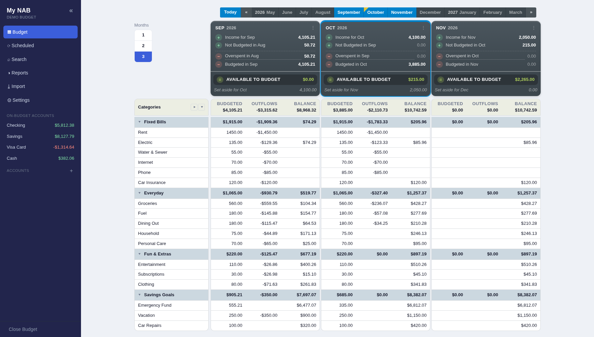
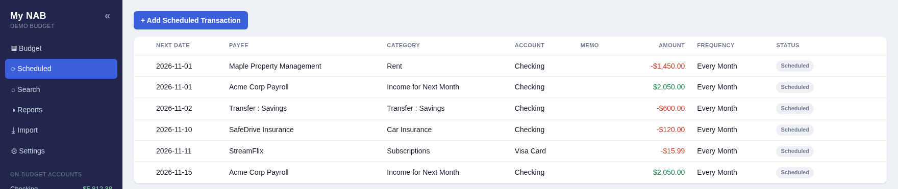
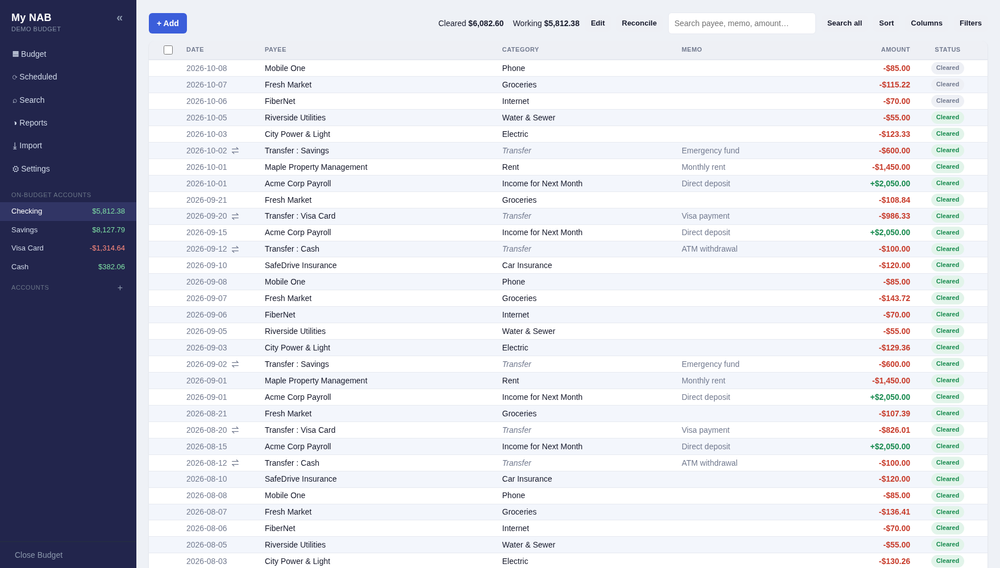
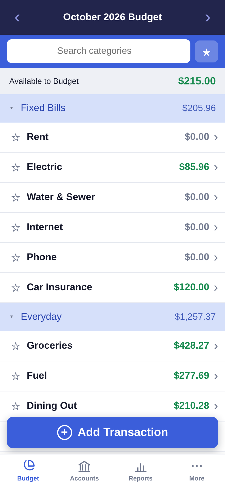

# My NAB: the full guide

(The short version is in the [README](../README.md). This is the detailed guide: every option, HTTPS, Synology, importing, reference.)

A self-hosted, classic envelope-style **zero-based budgeting** web app. Runs on your own computer or on a
home server / NAS, works from your phone too, and is protected by a single password. No subscription, no cloud.

- **Give every dollar a job** — a live *To be Budgeted* figure.
- **Rollover** — unspent money in a category carries to next month.
- **Roll with the punches** — cash overspending is pulled from next month's budget.
- **Credit cards** — budgeted like any other on-budget account: a charge is categorized directly, and paying
  the card is just a transfer between accounts.
- **Reports** — one date range (this month … custom) drives an overview with change vs. the previous period, a spending
  donut (click a slice for its transactions), top payees, income vs. spending, net worth (own vs. owe), category trends
  and budget vs. actual.
- **Import** — bank CSV/QFX/OFX files (with column mapping, match and duplicate review) and **Actual Budget** exports.
- **Multi-month budget view** (up to 3 months side by side) with an equation-style *Available to Budget* banner,
  a month strip, per-category and whole-month averages, and an adjustable text size.
- **Phone-friendly:** a simplified one-month budget with favorites, a quick Add Transaction flow, hide-from-view
  accounts, offline queueing, and per-device settings that are backed up on the server.

Everything is money-in-integer-cents, stored in a single SQLite file.

---

## What it looks like

These are screenshots of the built-in **Demo Budget** (made-up data).





| Account register | On a phone |
| --- | --- |
|  |  |

---

## Where do you want to run it?

| I want to… | Go to |
|---|---|
| **Try it out, or use it on one computer** (Windows, Mac or Linux). Everything stays on that computer. | [Part 1: Run it on your own computer](#part-1-run-it-on-your-own-computer) |
| **Keep it running all the time** on a NAS or home server, so my phone and other computers can use the same budget. | [Part 2: Run it on a server or NAS](#part-2-run-it-on-a-server-or-nas-always-on) |

Either way there is a ready-made **Demo Budget** (made-up data) to look around in, so you can see how it works
before entering anything of your own. Its password is **`demo1234`**.

**On this page:** [Part 1](#part-1-run-it-on-your-own-computer) ·
[Part 2](#part-2-run-it-on-a-server-or-nas-always-on) ·
[Importing your data](#importing-your-data) · [Reference](#reference)

---

# Part 1: Run it on your own computer

These options are for using My NAB on one computer. The downloadable programs only listen on that computer, so
nothing else can reach them. (The source-code and Docker options can also be reached from other devices on your
Wi-Fi, which is handy for trying it from your phone. For all-day access from every device, see Part 2.) Pick the
way that suits you:

- **[Download the program](#easiest-download-the-program)** — no installing, no commands. Windows, Mac and Linux.
- **[Run it from the source code](#run-it-from-the-source-code)** — needs Python; also the way to work on the app.
- **[Run it with Docker on your computer](#run-it-with-docker-on-your-computer)** — if you already use Docker.

## Easiest: download the program

Download from this project's **[Releases page](https://github.com/changedsoul/My_NAB/releases)** (under
**Assets**). Each download is a small folder with **two programs**, and it's worth knowing what each one does:

| Program | What it does |
|---|---|
| **My NAB Server** | Starts My NAB **in the background**. Nothing opens by itself; an icon (near the clock on Windows, in the menu bar on a Mac) shows it's running. **It keeps running when you close your browser** until you choose **Quit**. |
| **Open My NAB** | Opens your browser on the running server. If the server isn't running, it offers to start it. |

When it opens, the first screen lists your budgets. The ready-made **Demo Budget** is already there with its
password (**`demo1234`**) next to it. Click **Open** and look around, or click **+ New Budget → Set Up** to
start your own and choose a password. **Close Budget** (bottom of the left menu) takes you back to the list.

### Windows

1. Download **`My-NAB-windows.zip`**.
2. **Right-click the zip → Extract All…** (don't run it from inside the zip).
3. Open the extracted **My NAB** folder and double-click **My NAB Server**. If Windows says **"Windows
   protected your PC"**, click **More info → Run anyway** (that message shows for any program from an
   individual developer rather than a big company). Look for the My NAB icon near the clock (click the
   **^** arrow if it's hidden).
4. Double-click **Open My NAB**.
5. When you're done, right-click the My NAB icon near the clock and choose **Quit My NAB Server**.

Your budgets are saved in the **`data`** folder next to the programs. To update later, replace the two `.exe`
files with the new ones and keep your `data` folder. If anything goes wrong, a file named `My NAB.log` next to
the programs says what happened.

### Mac

1. Download **`My-NAB-mac-apple-silicon.zip`** (M1, M2, M3, M4 Macs) or **`My-NAB-mac-intel.zip`** (older
   Macs). Double-click the zip to unpack it, and drag the two apps to your **Applications** folder.
2. The first time, macOS blocks apps from developers it doesn't know. Double-click **My NAB Server**, click
   **Done**, then open **System Settings → Privacy & Security**, scroll down and click **Open Anyway** next to
   My NAB Server. Do the same once for **Open My NAB**. (If macOS says an app is "damaged", run
   `xattr -dr com.apple.quarantine "/Applications/My NAB Server.app" "/Applications/Open My NAB.app"` in Terminal.)
3. Open **My NAB Server** (look for its icon in the menu bar), then **Open My NAB**.
4. To stop it, click the menu-bar icon and choose **Quit My NAB Server**.

Your budgets are saved in `~/Library/Application Support/My NAB/data` (the menu-bar icon has **Open the data
folder**). Updating the apps never touches it.

### Linux

Two terminal programs in a `.tar.gz`, built on Ubuntu 22.04 (they need a reasonably recent Linux, glibc 2.35+):

```bash
tar -xzf My-NAB-linux.tar.gz && cd My-NAB-linux
./my-nab-server          # starts My NAB; leave the terminal open. Ctrl+C stops it.
./my-nab-server --stop   # from another terminal: stops it if it is running in the background
./open-my-nab            # in another terminal (or run ./install-launchers.sh to add both to your menu)
```

Or just open <http://localhost:8000> in your browser. Your budgets are saved in the `data` folder next to the
programs. (For an always-on server, use Part 2 instead.)

## Run it from the source code

Use this if there's no download for your system, or if you want to change the app. You need **Python 3.10 or
newer** ([python.org/downloads](https://www.python.org/downloads/)) and, to fetch the code with the commands
below, **git**.

**1. Get the code.** The project lives at <https://github.com/changedsoul/My_NAB>. Either:

```bash
git clone https://github.com/changedsoul/My_NAB.git
cd My_NAB
```

…or, without git, click the green **Code** button on that page, choose **Download ZIP**, unzip it, and open a
terminal (Windows: Command Prompt or PowerShell) in the unzipped `My_NAB` folder.

**2. Install and start it.**

| Windows (PowerShell or Command Prompt) | Mac and Linux (Terminal) |
|---|---|
| `py -m venv .venv` | `python3 -m venv .venv` |
| `.venv\Scripts\pip install -r requirements.txt` | `.venv/bin/pip install -r requirements.txt` |
| `.venv\Scripts\python app.py` | `.venv/bin/python app.py` |

**3. Open <http://localhost:8000>.** The first screen asks you to **set a password** for a new budget. Your
budget is written to `./data/nab.db`. Stop it with **Ctrl+C**. To start it again later, run just the last
command.

**Want to try the demo budget instead?** It's already in the `demo/` folder. Point the app at it:

| Windows PowerShell | Windows Command Prompt | Mac and Linux |
|---|---|---|
| `$env:NAB_DB_PATH = ".\demo\nab.db"`<br>`.venv\Scripts\python app.py` | `set NAB_DB_PATH=demo\nab.db`<br>`.venv\Scripts\python app.py` | `NAB_DB_PATH=./demo/nab.db .venv/bin/python app.py` |

Then open <http://localhost:8000> and use the password **`demo1234`**. Changes you make are saved in `demo/`. To
start the demo over, download the code again (or `git checkout demo`). Its dates move forward on their own, so
it always looks current. (To rebuild it: `python3 tools/make_demo.py --out demo --force`.)

**Working on the app:** frontend files (`static/`) just need a browser refresh; Python files (`*.py`) reload on
save when the app is started with `NAB_DEBUG=1`. To use it from your phone on the same Wi-Fi, use your computer's
address, e.g. `http://192.168.1.50:8000`. The built-in server is for testing; for always-on use, see Part 2.

## Run it with Docker on your computer

For a quick trial over plain HTTP (for an always-on setup with HTTPS, see Part 2). Needs
[Docker](https://docs.docker.com/get-started/get-docker/). In a terminal (Windows: PowerShell):

```bash
git clone https://github.com/changedsoul/My_NAB.git
cd My_NAB
docker build -t my-nab .
docker run -d --name my-nab --restart unless-stopped -p 8080:8000 -v "${PWD}/data:/data" my-nab
```

Open <http://localhost:8080>. (From your phone on the same Wi-Fi: `http://<this-computer's-address>:8080`.) Your
budgets are kept in `./data`. To update: `git pull`, `docker build -t my-nab .`, `docker rm -f my-nab`, then the
same `docker run`.

**The demo with Docker:** `docker compose -f docker-compose.demo.yml up -d --build`, then open
<http://localhost:8081> (password `demo1234`). When you're done: `docker compose -f docker-compose.demo.yml down`.

## Your data, backups and updates (Part 1)

- **Where it is:** the `data` folder (next to the programs, or in the project folder when run from source;
  `~/Library/Application Support/My NAB/data` for the Mac app).
- **Backup:** copy that folder (or use **Settings → Data & Backup** inside the app). It holds everything.
- **Update:** replace the program (or `git pull`) and keep the `data` folder. It's never touched by an update.
- **Remove the demo:** use the trash icon next to Demo Budget in the budget list.

---

# Part 2: Run it on a server or NAS (always on)

Choose this when you want My NAB **running all the time on a machine at home**, so your phone, laptop and
anyone else in your household use the **same budget**. It runs in **Docker**, and the same code runs there as
on your own computer.

**What you need**
- An always-on machine that can run Docker: a Synology (or other) NAS, a home server, a Raspberry Pi.
- A folder on it for your data (your budgets live there, outside the container, so updates never touch them).
- **HTTPS**, if you want it on your phone as an installable, offline-capable app (phones only allow that over
  HTTPS). Plain HTTP works fine for a browser on your home network.

## Any Linux server or home server (Docker Compose)

```bash
git clone https://github.com/changedsoul/My_NAB.git
cd My_NAB
docker compose up -d --build
```

`docker-compose.yml` is set up to sit **behind an HTTPS reverse proxy** (your NAS's built-in one, Caddy, nginx,
Traefik…): it publishes the app on `127.0.0.1:8080` only, so plain HTTP is never exposed on your network, and it
marks the login cookie Secure. Point your proxy at `http://localhost:8080`. For a quick trial **without** a proxy,
use the Docker command in Part 1 instead (it publishes `8080` to your network over plain HTTP). Your budgets are
in `./data`; set `NAB_SECRET_KEY` in the compose file if you want to pin the login-session key.

## Synology NAS (Container Manager)

The **exact same code** runs in Docker; nothing is rewritten.

### Option A: Container Manager (point-and-click)
1. Copy this whole folder to your NAS, e.g. `/volume1/docker/My_NAB`.
   (`python3 tools/make_nab.py` builds a clean, ready-to-copy `docker/My_NAB/` folder (and a `docker/My_NAB.tar.gz` of it) without your data.)
2. Open **Container Manager → Project → Create**.
3. Point it at the folder (it will use `docker-compose.yml`).
4. **Before starting**, edit `docker-compose.yml`:
   - Set `NAB_SECRET_KEY` to a long random string (keeps you logged in across restarts).
   - Change the volume line to a real NAS path, e.g. `- /volume1/docker/My_NAB/data:/data`.
   - Pick a host port that's free (DSM uses 5000/5001). Default here is `8080`.
5. Build and run, then set up HTTPS below.

### Option B: command line (if you have SSH)
```bash
cd /volume1/docker/My_NAB
docker compose up -d --build
```
(`./deploy.sh` does the same with plain `docker` commands, for older Synology versions without Compose.)

**Updating:** copy the new files over the old ones (never your `data` folder) and run the build again
(**Action → Build** in Container Manager, or `docker compose up -d --build`). Rebuilding never touches `data/`.

## Encrypting your budget on the NAS

Out of the box a budget is an ordinary SQLite file, so anyone who can copy your `data` folder can read it. On the
Docker / NAS version you can turn on **encryption** for a budget: **Settings → Data & Backup → Security → Encrypt…**
(the desktop programs don't have this).

- **What it protects against:** a copied data folder, a stolen or recycled drive, a leaked backup or a cloud sync of
  the folder, another app on the NAS. The file becomes unreadable without your password.
- **What it can't protect against:** someone with full (root) control of the NAS *while you are signed in*, because the
  server has to hold the key in memory to work. So the key is kept **only in memory**, and dropped when the last device
  closes the budget, or after **10 minutes without activity** from any device (change it with `NAB_LOCK_MINUTES`).
  Restarting the NAS or container always leaves the budget locked until you sign in.
- **Recovery key:** when you encrypt you get a recovery key, shown **once**. If you forget the password it is the only
  way back in, so keep it in a password manager or printed somewhere safe. (**Open → "Forgot the password?"**.)
- **Passkeys:** once encrypted you can add a passkey (a fingerprint, face, PIN or security key) and open the budget
  with it instead of typing the password. The passkey must support the WebAuthn *PRF* extension (iPhone and Mac with
  iCloud Keychain, recent Android, Windows Hello, most security keys) and the site must be on **https**. A passkey only
  works on the web address you added it from.
- **Backups:** a downloaded backup of an encrypted budget is encrypted too (a `.nabbackup` file) and can only be
  restored into an encrypted budget.
- **The calendar link** only works while someone is signed in (otherwise it answers "locked, try later").
- **Things to know:** the budget *names* are still visible in `registry.db`; old plain copies kept elsewhere (NAS
  snapshots, other backups) aren't touched, and encryption deletes the budget's older automatic backups from the
  server's `backups/` folder if you leave that box ticked; an encrypted install runs a single server process (the
  Docker image already does).

The encryption add-on (`sqlcipher3`) is installed in the Docker image automatically. If your NAS is an ARM model it
is built from source during `docker compose up --build`; if that isn't possible, Settings shows that encryption isn't
available on this server and everything else works as before.

**Tip for reaching it from outside:** a VPN (Tailscale or WireGuard) beats opening a port to the internet.

## HTTPS and reaching it from outside your home

Phones need HTTPS to install it and to work offline, and you should use it for any access from outside your
home. Use Synology's **reverse proxy** (Control Panel → Login Portal → Advanced → Reverse Proxy) with your DDNS
hostname, or reach it over your VPN / Tailscale. The single password guards the app, but HTTPS is strongly
recommended if it's internet-facing. Details are below.

### Setting up HTTPS (required for phone offline use)

Browsers only allow offline support on a secure origin, so the app has to be
reached over HTTPS. Two ways, depending on what you already have:

#### Option A (recommended): DSM reverse proxy with your existing NAS certificate

Nothing to copy, and certificate renewals stay in DSM. `docker-compose.yml`
already publishes the app on `127.0.0.1:8080` only (not on the LAN) and sets
`NAB_HTTPS=1`.

1. DSM → *Control Panel → Login Portal → Advanced → Reverse Proxy → Create*.
   - Source: protocol **HTTPS**, hostname = the name your DNS resolves to the NAS
     (e.g. `nas.home.lan`), port = an unused one (e.g. `8443`).
   - Destination: protocol **HTTP**, hostname `localhost`, port `8080`.
2. *Control Panel → Security → Certificate → Settings*: make sure that
   hostname is assigned to your certificate (the certificate must list it, as a
   Common Name or Alternative Name).
3. Browse to `https://nas.home.lan:8443` on the phone. Your CA must be trusted
   there (below), and the NAS firewall (if on) must allow that port.

A different hostname per app (e.g. `nab.home.lan` on 443) also works if the
certificate covers it, e.g. via a wildcard or extra Alternative Name.

#### Option B: the app serves HTTPS itself

Use this if there's no reverse proxy. In `docker-compose.yml`, publish the port
as `"8080:8000"`, uncomment the `GUNICORN_CMD_ARGS` line and the `./certs` volume,
and put a full-chain certificate and key in `certs/` named exactly `server.crt`
and `server.key` (`chmod 600` the key). For a certificate from pfSense's Cert
Manager: use *Create an Internal Certificate*, a lifetime of 398 days or less,
and add the hostname (and the NAS's IP, if you'll browse by IP) as Alternative
Names, since Chrome/Android ignore the Common Name. If your CA is an
intermediate, append its certificate to the `.crt` (server first).

Running locally with HTTPS: `NAB_TLS_CERT=server.crt NAB_TLS_KEY=server.key
.venv/bin/python app.py` (both must be set).

#### Trust your CA on the phone (once)

Install your CA certificate (not the server's):
- *Android:* Settings → Security → Encryption & credentials → Install a
  certificate → **CA certificate**.
- *iOS:* open the CA `.crt` to install the profile, then Settings → General →
  About → Certificate Trust Settings → enable it.

Then open the HTTPS address, let it load once while online, and use *Add to Home
screen* / *Install app*. With Option B (or any manually issued certificate),
renew it before it expires or the app will stop loading on the phone.

### Adding it to an iPhone's Home Screen

iPhones don't show an install prompt; you add it by hand, and it then opens as
its own app (no Safari address bar), just like on Android.

1. **Trust your CA on the iPhone first** (HTTPS must be valid). Open the CA's
   `.crt` file to install the profile (Settings → *Profile Downloaded*), then
   Settings → General → About → **Certificate Trust Settings** → switch **on**
   full trust for it. Skipping that last step is the usual reason it doesn't work.
2. Open `https://your-hostname` in **Safari** and let it finish loading.
3. Tap **Share → Add to Home Screen → Add**. (iOS 16.4+ also allows this from
   Chrome and Firefox on the iPhone.)
4. Open it from the new icon. It's a separate space from Safari, so **sign in
   again** there; the offline copy and queued changes are kept per app.

Notes: queued offline changes sync when you next open the app (iOS doesn't run it
in the background). The iPhone's decimal keypad has no minus or plus key, so to
type a negative amount or a sum like `50+25` in a budget cell, switch the keypad
to the full keyboard with its **ABC** key.

### Offline use

The app works without a connection once it has been loaded online at least
once: the app shell and the last data you viewed are cached, and **transaction
add/edit/delete and budget-cell edits** made offline are queued on the device
and replayed automatically when the server is reachable again. A small pill at
the bottom-right shows `Offline`, `N pending`, or `N need attention` (tap it to
review, retry, or discard queued changes). If someone else changed the same
transaction first, your queued edit is held for review instead of overwriting
theirs.

- **Needs HTTPS** (or `localhost`). Browsers only allow offline support on a
  secure origin, so a phone using plain `http://192.168.x.x:8000` will *not* get
  it. See [HTTPS](#setting-up-https-required-for-phone-offline-use) above.
- Server-computed numbers (To Be Budgeted, Available, reports) are not
  recalculated offline; they refresh from the server once the queue syncs.
- Other changes (categories, accounts, imports, settings) still need a
  connection.

---

## Importing your data

**Import** in the sidebar.

- **QFX / OFX (recommended for banks):** pick the target account and upload the
  `.qfx`/`.ofx` file your bank offers. Click **Review & choose transactions** to
  open a full-size table showing every row as **new** or **duplicate**, *why* it
  was flagged, and which existing transaction it matched. Tick any flagged row to
  import it anyway (handy for false positives), or use *New only* / *Select all*.
  Duplicates are detected by the bank's transaction id (FITID) first, then by a
  heuristic — same dollar amount, same payee name, within a date window you set
  (default ±2 days).
- **Undo:** every import is recorded under **Recent imports** at the bottom of the
  Import page. One click removes exactly the transactions that came in with that
  import; anything you entered by hand is never touched.
- **Bank CSV:** pick the target account, upload the CSV, map the columns
  (Date / Payee / Amount, or separate Outflow / Inflow). The same duplicate
  skipping is available via the *Skip duplicates within N days* checkbox.
- **Actual Budget:** in Actual, go to *Settings → Export data* to get a `.zip`,
  then upload it. Accounts, categories, transactions, and budget amounts come in.
  Accounts whose name looks like a credit card (“visa”, “card”, “credit”, …) are
  imported as credit cards; you can change any account's type afterward.

### Possible matches and duplicates in an import

Both the bank-file (QFX/OFX) and CSV imports have a **Review & choose…** screen
that shows, before anything is saved, what will happen to every row:

- **Flagged duplicate** — the same bank ID, or the same amount *and exactly the
  same payee* within the "days" window. Unticked by default.
- **Possible match** — a transaction you entered by hand with the *same amount*,
  within the "days" window, whose payee starts with the *same first three
  letters* ("Amazon" ~ "AMAZON MKTP US"). Your entry is shown right beside the
  bank row with how far apart they are. **Match** is ticked by default: the bank
  row is merged into your entry (yours wins; a blank payee/memo is filled from
  the bank row). Untick **Match** to add the bank row as a new transaction
  instead, or untick **Add** to leave it out.
- **New** — everything else.

Matched rows are remembered (the bank ID, or the bank's date/payee/amount for
CSV), so importing the same file again won't add them back. **Quick import** /
**Import without review** skip exact duplicates and *hold back* possible matches
rather than guessing. Entries that already came from a bank import are never
offered as match targets. Setting the days window to 0 (or unticking "skip
duplicates" for CSV) turns all of this off.

If a duplicate is already in your register, tick the two transactions in the
account register, open the **N selected** menu, and choose **Match imported with
manual…** (same account and amount; your entry is kept, the imported copy is
removed, and the bank's details are remembered the same way).

---

---

# Reference

## Configuration (environment variables)

| Variable                       | Default            | Purpose                                         |
|--------------------------------|--------------------|-------------------------------------------------|
| `NAB_DB_PATH`                  | `./data/nab.db`    | Where the SQLite database lives.                |
| `NAB_SECRET_KEY`               | generated & stored | Session signing key. Set a fixed one in Docker. |
| `PORT`                         | `8000`             | Port for the local dev server (`app.py`).       |
| `NAB_TLS_CERT` / `NAB_TLS_KEY` | unset              | Serve HTTPS from the dev server (set both).     |
| `NAB_HTTPS`                    | off                | Mark the session cookie Secure (set in Docker). |
| `NAB_LOCK_MINUTES`             | 10                 | Minutes of inactivity before an encrypted budget locks itself (Docker). |

On a server, set these in `docker-compose.yml`. The desktop programs set what they need themselves.

## How the budget math works (notes)

- Money is stored in **integer cents**. Amounts are signed from the account's
  point of view: negative = outflow, positive = inflow.
- **Income** = inflows assigned to the *Inflow: To be Budgeted* category on an
  on-budget account. These raise that month's *To be Budgeted*.
- **A category's Available** = carried-over available + budgeted this month +
  activity this month. Positive balances roll into next month.
- **Cash overspending** (a normal category going negative) resets to 0 at month
  end and reduces the *following* month's To be Budgeted — the classic rule.
- **Credit cards:** a `credit`-type account is budgeted exactly like checking or
  savings — a charge is categorized directly and counts as that category's
  activity, same as any purchase. Paying the card is an ordinary transfer
  between accounts, which (like any transfer) never touches a category or *To
  be Budgeted*. The card's own account balance is the record of what's owed.

## Project layout

```
app.py              Flask app: configuration, security headers, blueprint registration
api/                The HTTP API, one module per area (budget, transactions, imports, ...)
db.py               SQLite schema, migrations, connections
budget_engine.py    Zero-based envelope math (rollover, To be Budgeted)
importers.py        Bank CSV/QFX/OFX + Actual Budget importers
static/             The no-build web UI (HTML/CSS/vanilla JS)
demo/               The ready-made demo budget
desktop/            The "My NAB Server" / "Open My NAB" desktop programs
packaging/, .github/workflows/            How the Windows, Mac and Linux downloads are built
tools/              make_demo.py (rebuilds the demo budget), make_nab.py (builds a copy-to-NAS folder)
Dockerfile, docker-compose.yml, docker-compose.demo.yml, deploy.sh   Docker / NAS setup
```
